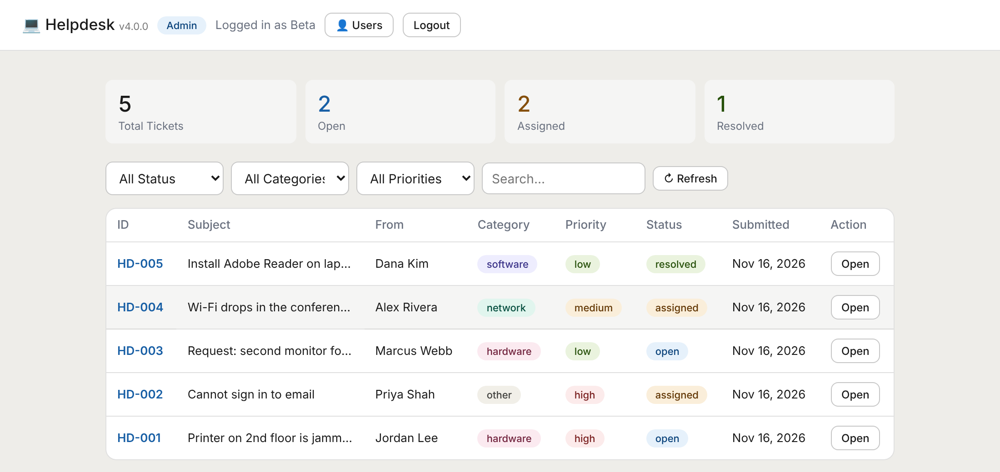

# Helpdesk

**A small, self-hosted help desk for a Raspberry Pi or any computer on your network.**
People submit tickets from a simple web page; your team works them from a dashboard.
No database, no framework, no cloud account: plain Node.js and two JSON files.



## Features

* **Ticket form for everyone, no login needed.** Name, email, subject, category, priority. Submitters can check their ticket's status later with the ticket ID plus their email address.
* **Staff dashboard.** Counts, filters, search, assign a ticket to a person, write the resolution, move it between Open, Assigned and Resolved.
* **Email notifications (optional, Gmail).** The admin gets new tickets, the submitter gets a confirmation and status updates, the assigned tech is emailed when a ticket is assigned to them and when it is resolved. Messages are queued and retried, and *Recent email activity* shows what was sent and what failed.
* **Admins and agents.** Admins manage users and email settings; agents work tickets.
* **Built to be safe on a small network.** Hashed passwords with forced first-login change, rate limiting, escaped output, owner-only data files. See [Security notes](#security-notes).
* **Easy to run and easy to update.** One `setup.sh` to install, one `update.sh` to update, and plain-English guides for people who are not technical.

## Requirements

* A Raspberry Pi, or any Linux box (Ubuntu/Debian are what it is tested on), or any machine that runs Node.js.
* Node.js 18 or newer. `setup.sh` offers to install it for you.
* Optional: a Gmail account with an App Password, for email notifications.

## Quick start

```bash
git clone https://github.com/YOUR-USERNAME/helpdesk.git
cd helpdesk
bash setup.sh          # as your normal user, not root
```

`setup.sh` checks for Node 18+, installs the one dependency (`nodemailer`, used only for email), creates a systemd service for your user and folder, and starts it.

Then open `http://<your-pi-address>:3000`. Staff click **Admin Login**.

On the very first start the server creates an administrator named `Beta` with a **random one-time password** printed to the log:

```bash
sudo journalctl -u helpdesk -n 40 --no-pager | grep -E 'username|password'
```

You must change it at first login. Lost it? `node server.js --reset-admin`.

Just want to try it without installing a service? `npm install && node server.js`.

## Guides (plain English)

Written for people who have never used a terminal. Start with **Install.txt** if you are new.

| File | What it is |
| --- | --- |
| [Install.txt](Install.txt) | Setup from zero, step by step, including how to turn the login password off and on |
| [START-HERE.txt](START-HERE.txt) | Adding helpers, everyday use, email setup, common problems |
| [HOW-TO-GET-HELP.txt](HOW-TO-GET-HELP.txt) | One page to hand to the people who submit tickets |
| [Update.txt](Update.txt) | Moving to a newer version with one command |
| [Uninstall.txt](Uninstall.txt) | Removing Helpdesk, or starting over |

## Security notes

* **Keep it on your own network.** It speaks plain HTTP. Do not port-forward it to the internet. For remote access, put it behind a reverse proxy with HTTPS (for example Caddy) or a VPN such as WireGuard or Tailscale.
* Passwords use scrypt with a per-user salt, a 10-character minimum and a constant-time compare.
* Login attempts are throttled per IP and per username; ticket submission and lookups are rate limited.
* Ticket lookup needs the ticket ID **and** the email address it was submitted with.
* Data files are written atomically with owner-only permissions (`600`). Your logins, tickets and Gmail app password live in `users.json`, `tickets.json` and `email-config.json`, which are in `.gitignore`. Never commit them.
* Admin actions are logged as `[audit]` lines (`journalctl -u helpdesk | grep audit`).
* Run `npm audit` now and then and keep Node and `nodemailer` updated.

Found a security problem? Please open a private report via the repository's **Security** tab rather than a public issue.

---

# Technical reference

## Configuration (environment variables)

| Variable | Default | Purpose |
| --- | --- | --- |
| `PORT` | `3000` | Listen port |
| `HOST` | `0.0.0.0` | Bind address (`127.0.0.1` when behind a reverse proxy) |
| `DATA_DIR` | app folder | Where `tickets.json`, `users.json`, `email-config.json` live |
| `TRUST_PROXY` | off | Set to `1` only behind your own reverse proxy (uses `X-Forwarded-For` for rate limiting) |
| `HELPDESK_MAIL_FIXTURE` | – | Tests only: path to a fake mail transport (see `fixtures/fake-mail.js`) |
| `HELPDESK_MAIL_RETRY_MS` / `HELPDESK_MAIL_TIMEOUT_MS` | `30000,120000,600000` / `45000` | Retry delays and per-send time limit (mostly for tests) |
| `GMAIL_APP_PASSWORD` | – | Overrides the app password in `email-config.json`; put it in `/etc/helpdesk.env` (`chmod 600`) |
| `OPEN_ACCESS` | off | `on` enables the optional no-password staff console (see "Open access" below) |

The systemd unit reads `/etc/helpdesk.env`, so on the Pi these are set with one `NAME=value` per line in that file
followed by `sudo systemctl restart helpdesk`.

### Open access (optional "no password" mode)

With `OPEN_ACCESS=on`, a **Staff Console (no password)** button appears for visitors on the private network.
It grants **agent** level only (work tickets). It never grants admin: users, email settings, password resets and
ticket deletion still need a real login. Guardrails, all enforced server-side:

* the connection must come from a private/loopback/link-local address (10/8, 172.16/12, 192.168/16, 169.254/16, `::1`, `fc00::/7`, `fe80::/10`);
* requests carrying proxy headers (`X-Forwarded-For`, `Forwarded`, `X-Real-IP`) are never treated as local;
* the `Host` header must be an IP address, `localhost`, a single-word name, or end in `.local/.lan/.home/...` (blocks DNS-rebinding from public names);
* an explicit login token always wins, and a bad token is refused rather than falling back to open access;
* it can only be switched on by editing a root-owned file on the machine, never from the web UI;
* the server logs a warning at start-up while it is on.

It is still a trade-off: everyone on the LAN, guests included, can read tickets while it is on.

## Roles

* **Admin**: tickets, users, email settings, can delete tickets.
* **Agent**: view and work tickets. No user management, no email settings, no deleting.

New users and admin-reset passwords must be changed at next login.

## Updating

```bash
cd ~/helpdesk-v4
bash update.sh                  # finds the newest helpdesk-v*.zip in ~, ~/shared, ~/Downloads
bash update.sh /path/to/x.zip   # or name it
```

`update.sh` unpacks the zip to a temp folder, prints the old and new version and asks before
continuing (it warns if the zip is the same version), saves `tickets.json`, `users.json` and
`email-config.json` to `backup-<timestamp>/`, copies the program files over, runs `npm install`,
regenerates and installs the systemd unit, and restarts the service. Data files are never in the zip.
The running version is shown in the page header, in the start-up log line and in `GET /api/config`.
Flags for testing: `HELPDESK_UPDATE_YES=1`, `HELPDESK_UPDATE_SKIP_NPM=1`, `HELPDESK_UPDATE_SKIP_SERVICE=1`.

## What's new in v4 (since v3)

* **Email is queued, retried and logged.** Sends no longer block the request; failures retry after
  30 s, 2 min and 10 min (not on a rejected login); 15 s connect timeout, IPv4 to `smtp.gmail.com:465`.
  Admin → Email shows *Recent email activity* (SENT / RETRYING / FAILED / DROPPED). Send Test reports
  the real reason in plain words. Per-recipient cap raised from 3 to 10 per hour, and drops are logged.
* **Assignee is emailed** when a ticket is assigned to them (setting `notifyAssignee`, on by default;
  not for self-assignment).
* **Resolved tickets email both** the submitter and the assigned technician.
* **Users → Email button** (`PUT /api/users/:name/email`, admin) to set or clear an account's address;
  assignee and resolved emails need it.
* **Save feedback:** `PUT /api/tickets/:id` returns a `notice` field saying whether the assignee email was queued or why not; the UI shows it.
* **Rollback fix:** the page no longer forces `assigned` when you choose Open on a ticket that already has an assignee.
* **Version shown** in the UI, start-up banner and `/api/config`.
* **`update.sh`** and the v3 → v4 data hand-over in `setup.sh`.

## What changed from v2

| Area | v2 | v3 / v4 |
| --- | --- | --- |
| Rendering ticket text | Inserted as raw HTML (script in a ticket ran in the admin's browser) | Escaped everywhere; dropdowns built with the DOM |
| Static files | `/../email-config.json` could escape `public/` | Strict allow-list, resolved and symlink-checked inside `public/` |
| Default login | `Beta` / `Alpha`, printed by setup | Random one-time password, forced change |
| Password hashing | One round of SHA-256 | scrypt; old hashes upgrade automatically on next login |
| Ticket lookup | Anyone, by sequential ID | ID + matching email, rate limited |
| Emails | Unescaped HTML, unlimited, sent inline | Escaped, capped (10/recipient/h, 60/h), queued with retries (30 s, 2 min, 10 min), 15 s connect timeout, activity log in Admin → Email |
| Request bodies | Unlimited, any content type | 64 KB cap, JSON only |
| CORS | `*` | None (same origin only), plus CSP and other security headers |
| Roles | Everyone admin | Admin and agent |
| Service file | Hard-coded user `pi` | Generated for your user, with systemd hardening |
| Node install | `curl | bash` of Node 20 (end of life) | Distro package, Node 18+ |

### Upgrading from v2

Copy your `tickets.json`, `users.json` and `email-config.json` into the v4 folder. Old password
hashes are upgraded on each user's next successful login, and anyone still using `Alpha`
is forced to change it. Tickets are compatible as they are.

## Tests

```bash
npm test
```

Starts real server instances on random ports with temporary data folders and checks path
traversal, auth, forced password change, roles, rate limits, request limits, ticket tracking
and the v2 upgrade path. Needs Node 18+ and nothing else.

## Possible next steps

* A strict Content-Security-Policy needs the page's inline `onclick` handlers moved to
  `addEventListener`; output escaping is the main protection today.
* Optional TLS directly in Node, or a documented Caddy config.
* Attachments, ticket comments and a search box.

## License

MIT. See [LICENSE](LICENSE).
